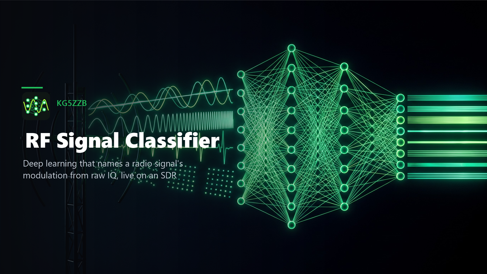
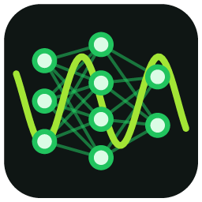
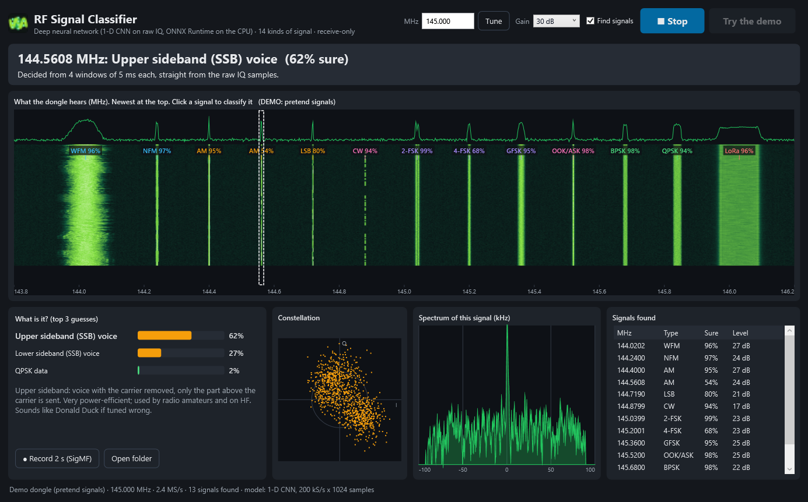
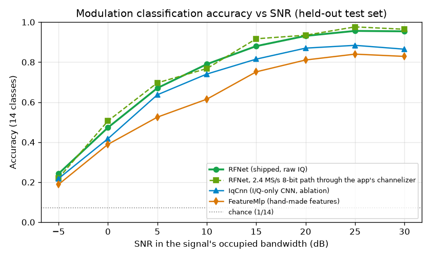

# KG5ZZB - RF Signal Classifier





**Deep-learning modulation classification for Windows with a low-cost RTL-SDR: click a signal on the waterfall and a 1-D convolutional neural network says what it is, straight from the raw IQ samples.**

The app shows 2.4 MHz of spectrum live. Click a signal (or let the app find every signal by itself) and it cuts that channel out of the I/Q stream, mixes it to baseband, filters and decimates it to 200 kS/s, and a PyTorch-trained neural network, running on the CPU with ONNX Runtime, classifies the modulation into one of 14 classes. You get the top-3 answers with probabilities, a plain-language explanation, a constellation plot and the channel's spectrum, and you can record the signal as a **SigMF** file annotated with the predicted label.

It is **receive-only**: it never transmits.



> **Status: v0.1.0.** Channelizer, signal finder, deep neural network (RFNet), SigMF recorder, live waterfall UI and a built-in demo band all work. 19 automated tests, including a bit-level check that the C# preprocessing matches the Python training pipeline and that ONNX Runtime in C# reproduces PyTorch's probabilities.

---

## What it does

### 📡 Live waterfall, click to classify
- RTL-SDR at **2.4 MS/s**: live spectrum plus waterfall of the whole 2.4 MHz.
- **Click a signal** and the app snaps to it; or tick **Find signals** to detect every emitter automatically (Welch spectrum, median noise floor, thresholding, gap merging, power-weighted centroid).
- Each signal is classified twice a second; four 5 ms windows are combined (mean log-probability) for a steady answer.

### 🧠 Deep learning on raw IQ: 14 modulation classes

| Class | Typical use |
|---|---|
| AM | Aircraft (airband), AM broadcast, CB |
| WFM | FM broadcast (music, 19 kHz pilot, stereo) |
| NFM | Two-way radio, repeaters, marine VHF |
| USB / LSB | Single-sideband voice (amateur, HF) |
| CW | Morse code |
| 2-FSK | Pagers, telemetry, RTTY |
| 4-FSK | Digital voice radio (DMR / P25 / dPMR style) |
| GFSK | Bluetooth-style and IoT radios |
| OOK / ASK | Remotes, key fobs, sensors |
| BPSK / QPSK | Satellite and data links |
| LoRa | Chirp spread spectrum IoT (LoRaWAN, Meshtastic) |
| Noise | No signal |

### 🔍 See why
- **Top-3 probabilities** with bars, and a plain-English explanation of the winning class.
- **Constellation (IQ scatter)** and the **channel spectrum** of exactly the 200 kHz the network looked at.

### 💾 SigMF recording
- **Record 2 s** saves the channelized signal (200 kS/s, `cf32_le`) as `.sigmf-data` + `.sigmf-meta`, with `core:sample_rate`, `core:frequency`, `core:datetime`, `core:hw`, `core:recorder` and an **annotation** carrying the predicted label (`core:label`) and the top-3 probabilities (`core:comment`), per the [SigMF](https://sigmf.org) specification v1.2.x. Ready for dataset building and other RF machine-learning tools.

### 🎬 Try it without hardware
**Try the demo** (or start with `--demo`) runs a simulated band with **13 transmitters at once**, one of each class: wide FM, NFM, AM, USB, LSB, CW, 2-FSK, 4-FSK, GFSK, OOK, BPSK, QPSK and LoRa, spread across 2.4 MHz. The demo band comes from a separate C# signal simulator, streamed as 8-bit I/Q exactly like a dongle.

---

## How the neural network is built

```
rfsim.py (numpy)                train.py (PyTorch)                        App (C#, ONNX Runtime)
14 modulations, random     ->   RFNet: fixed IQ front end           ->    embedded modulation_classifier.onnx
offsets, timing, sample-        (I, Q, |x|, phase step, STFT as Conv1d)   Channelizer.cs = dsp_ref.py
rate offset, phase noise,       + time CNN + spectrum CNN -> 14 classes   (parity test on raw dongle bytes)
fading, multipath, AWGN,        baselines: IqCnn, FeatureMlp              CPU inference, ~0.5 ms per window
channel filter, 1024 IQ         per-class, per-SNR, confusion matrix
```

- **Data:** a Python script generates 1024-sample windows at 200 kS/s for every class with random parameters (symbol rate, deviation, roll-off, spreading factor, voice/music content), carrier offset ±5 kHz, random phase and symbol timing, ±100 ppm sample-rate offset, oscillator phase noise, Rician/Rayleigh fading with Doppler, multipath echoes, AWGN at **SNR -5 to 30 dB** (in the signal's occupied bandwidth), the app's own channel filter and power normalisation. 56,000 training windows, 22,400 held-out test windows on a separate seed.
- **Model (RFNet, 188,974 parameters):** the input is raw IQ `[N, 2, 1024]`. A fixed front end inside the network computes amplitude, the sample-to-sample phase step, and a 256-point short-time spectrum (a DFT implemented as a strided `Conv1d` with fixed cosine/sine kernels). A time-domain CNN and a spectrum CNN are pooled and joined by a small classifier. Trained with AdamW, one-cycle LR, label smoothing and phase-rotation augmentation in 34 minutes on a laptop CPU.
- **Baselines:** the same CNN on I/Q only (ablation) and a classical MLP on 22 hand-made features (higher-order cumulants C40/C41/C42/C63, x² and x⁴ spectral lines, spectral shape, envelope and instantaneous-frequency statistics).

### Results on the held-out test set

| Model | Accuracy (all SNR) | Accuracy (SNR ≥ 10 dB) | Macro F1 |
|---|---|---|---|
| **RFNet (shipped)** | **73.7%** | **90.2%** | **0.741** |
| IqCnn (I/Q only) | 68.1% | 83.5% | 0.681 |
| FeatureMlp (hand-made features) | 61.8% | 76.9% | 0.616 |



RFNet is right **93-96% of the time at 20 dB SNR and above**, 79% at 10 dB and 47% at 0 dB (chance is 7%). WFM and LoRa are recognised almost perfectly. Most mistakes are weak narrow signals (CW, SSB) called Noise at low SNR; the hardest pairs are 4-FSK vs NFM, AM vs CW, GFSK vs 4-FSK and USB vs LSB. The deep network beats the classical feature-based baseline by 12 points overall and 13 points at 10 dB and above, and the fixed IQ front end (amplitude, phase step, STFT) adds 6 points over the plain I/Q CNN.

**Same network, real preprocessing path:** 1,344 test signals rendered at 2.4 MS/s anywhere in the band, quantised to 8 bits like an RTL-SDR and passed through the app's channelizer score **74.8%** (91.2% at 10 dB and above), matching the 73.7% above. On the demo band, whose 13 transmitters come from an independent C# simulator, **51 of 52** decisions are correct (automated test).

The full model card, per-class precision/recall/F1, recall vs SNR for every class and the confusion matrix are in **[docs/MODEL.md](docs/MODEL.md)**. An optional script, a Python script , scores the model on the overlapping classes of DeepSig's public RadioML 2018.01A dataset if you download it.

## Architecture

| Layer | What it does |
|---|---|
| Hardware | P/Invoke bindings to librtlsdr, async streaming, retune with stale-buffer discard, USB error retries |
| DSP | Mixer, 257-tap Blackman FIR, decimation by 12, normalisation; Welch spectrum; FFT; channel finder |
| Machine learning | Synthetic IQ generator, PyTorch training of RFNet and two baselines, ONNX export, ONNX Runtime inference, window combining |
| Pipeline | Sample ring buffer, spectrum frames, detection, per-channel classification, recording |
| Recording | SigMF `cf32_le` data + metadata with label annotation |
| Simulation | 13 streaming transmitters (voice, music, Morse, FSK, PSK with RRC, LoRa chirps) and a pretend dongle |
| UI | WPF: clickable waterfall, top-3 bars, constellation, channel spectrum, signal list |
| Tests | Python/C# parity, ONNX vs PyTorch, accuracy on fresh IQ, SigMF validity, end-to-end demo |

## Requirements
- Windows 10 or 11, 64-bit.
- An RTL-SDR dongle (RTL2832U + R820T/R828D tuner) with the WinUSB driver (install once with [Zadig](https://zadig.akeo.ie/)). Tested with a Nooelec NESDR SMArt v5.
- No dongle? The demo works without one.

## Recommended hardware

| Item | What to use | Why |
|---|---|---|
| **SDR dongle** | **1** RTL-SDR (RTL2832U + R820T/R828D). | The app shows and classifies 2.4 MHz at a time; one dongle is all it uses. |
| **Antenna** | A **wideband discone** (about 25 MHz to 1.3 GHz), or any antenna made for the band you want to explore. | A discone lets you classify signals across many bands (airband, amateur, marine, ISM, broadcast) with one antenna. Mount it high and clear of metal. |
| **Coax** | Short, low-loss coax (for example RG-6 or LMR-240 class) between antenna and dongle. | Long thin coax loses a lot of signal at VHF/UHF. |
| **Optional** | An FM-broadcast notch filter. | Near strong FM stations it keeps the dongle from overloading, which would add false signals to the waterfall. |

HF (below about 24 MHz) needs a dongle that supports direct sampling or an upconverter.

## Scope
- An RTL-SDR covers about 24 MHz to 1.7 GHz; the app shows 2.4 MHz at a time.
- Receive-only. Listening to some services is restricted in some countries; know your local rules.

## Source code
This repository is the public showcase: description, results, model card and images.
The source code is private. Technical walkthroughs are available on request.

## License
Copyright (c) 2026 KG5ZZB. All rights reserved. Text and images may not be reused without permission.
