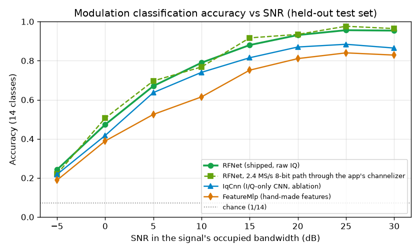
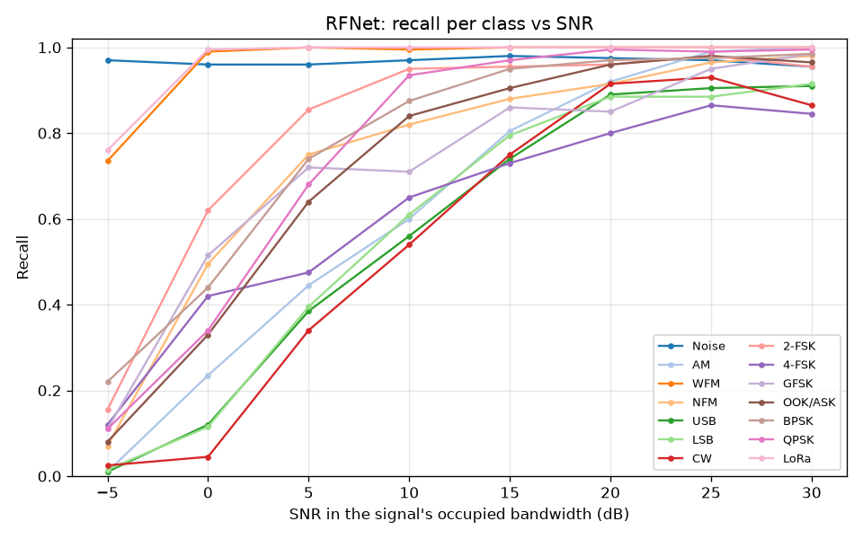
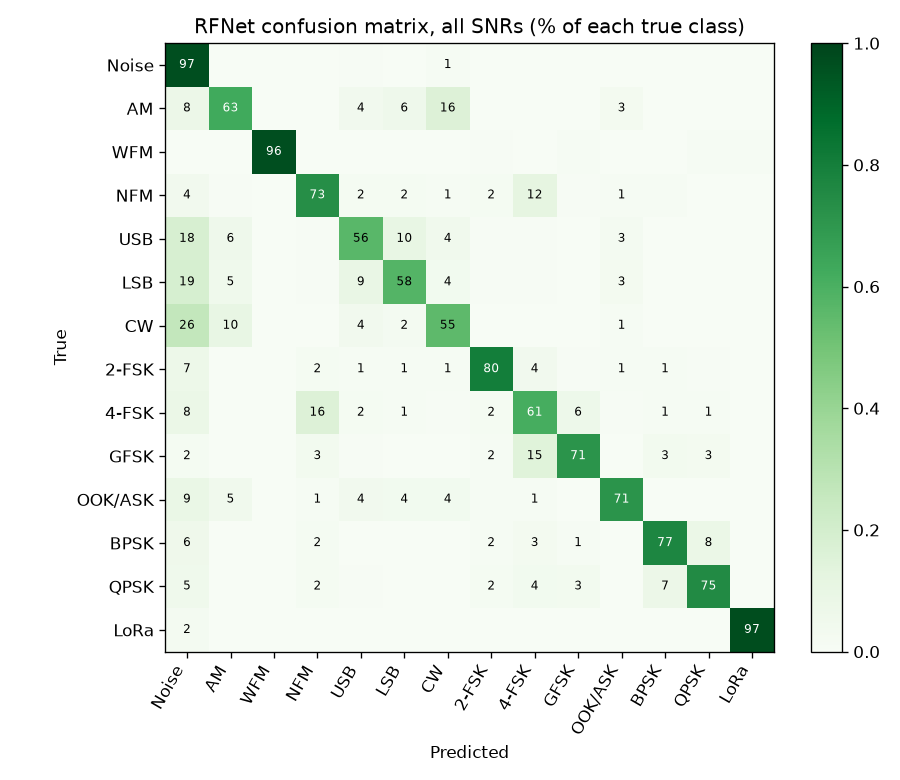

# Modulation classifier: model card

## What it does
Given 1024 complex baseband samples of one signal (5.12 ms at 200 kS/s), the network says which of
14 modulation classes it is, with a probability for each class. It runs on the CPU inside the app with
ONNX Runtime and needs no internet.

| # | Class | What it is |
|---|---|---|
| 0 | Noise | No signal: only receiver noise |
| 1 | AM | Amplitude modulation with voice (airband, AM broadcast, CB) |
| 2 | WFM | Wideband FM with music, 19 kHz pilot, sometimes stereo (FM broadcast) |
| 3 | NFM | Narrowband FM voice, 1.5-5 kHz deviation, sometimes a CTCSS tone (two-way radio) |
| 4 | USB | Upper sideband voice (amateur HF/VHF, marine) |
| 5 | LSB | Lower sideband voice |
| 6 | CW | Morse code: a keyed carrier, 12-35 words per minute |
| 7 | 2-FSK | Two-tone frequency shift keying, 1.2-12 kBd, modulation index 0.8-2.5 |
| 8 | 4-FSK | Four-level FSK, 1.2-9.6 kBd (DMR / P25 / dPMR style) |
| 9 | GFSK | Gaussian-filtered FSK, 4.8-40 kBd, index 0.3-0.7, BT 0.3-0.5 (Bluetooth / pager / IoT style) |
| 10 | OOK/ASK | On-off or amplitude shift keying, 0.5-10 kBd (remotes, sensors) |
| 11 | BPSK | Binary phase shift keying, root-raised-cosine, 2.4-40 kBd, roll-off 0.2-0.5 |
| 12 | QPSK | Quadrature PSK, same shaping |
| 13 | LoRa | Chirp spread spectrum, 62.5 / 125 kHz, SF7-SF10 |

## Data (generated by a Python script )
- **Sample rate and window:** 200 kS/s, 1024 samples. The app gets there from the RTL-SDR's 2.4 MS/s by
  mixing the chosen signal to 0 Hz, a 257-tap Blackman low-pass (cutoff 88 kHz) and decimation by 12.
- **Impairments, all random per window:** carrier offset +-5 kHz and phase, symbol timing, sample-rate offset
  up to +-100 ppm, oscillator phase noise (50%), 1-2 multipath echoes up to 15 us (50%), Rician/Rayleigh flat
  fading with 1-60 Hz Doppler (50%), AWGN, the app's channel filter, unit-power normalisation.
- **SNR** is the signal-to-noise ratio inside the signal's occupied bandwidth (floored at 1 kHz), i.e. how
  far the signal stands above the noise floor on a waterfall. A 3 kHz voice signal at 0 dB is therefore
  about 18 dB below the total noise in the 200 kHz window, which is why narrow signals need positive SNR.
- **Train** 56000 windows (seed 1, SNR uniform -5..30 dB), **validation** 5600 (seed 2, model selection),
  **test** 22400 (seed 3, 200 per class at each of -5, 0, 5 ... 30 dB, never used for training or selection).

## Models
| Model | Input | Parameters |
|---|---|---|
| **RFNet** (shipped) | raw IQ -> fixed front end (I, Q, amplitude, phase step; 256-pt STFT log spectrum as a fixed Conv1d) -> time CNN + spectrum CNN -> MLP | 188,974 |
| IqCnn (ablation) | raw I/Q only -> the same time CNN -> MLP | 121,934 |
| FeatureMlp (classical baseline) | 22 hand-made features (cumulants C40/C41/C42/C63, x^2 and x^4 spectral lines, spectral shape, envelope and instantaneous-frequency statistics) -> MLP | 12,878 |

Training: AdamW, one-cycle learning rate (max 2e-3), batch 256, 10 epochs, label smoothing 0.05, random
phase rotation as augmentation, best epoch on the validation set. RFNet trained in 34 minutes on a
CPU (8 threads, no GPU). ONNX file 1776 KB; about 0.54 ms per window on the CPU (PyTorch, batch 64).

## Results on the held-out test set
| Model | Accuracy (all SNR) | Accuracy (SNR >= 10 dB) | Top-3 accuracy | Macro F1 |
|---|---|---|---|---|
| **RFNet** | **0.737** | **0.902** | **0.899** | **0.741** |
| IqCnn (raw I/Q only) | 0.681 | 0.835 | 0.872 | 0.681 |
| FeatureMlp (hand-made features) | 0.618 | 0.769 | 0.850 | 0.616 |

### Accuracy vs SNR

| Model | -5 dB | 0 dB | 5 dB | 10 dB | 15 dB | 20 dB | 25 dB | 30 dB |
|---|---|---|---|---|---|---|---|---|
| RFNet | 0.24 | 0.47 | 0.67 | 0.79 | 0.88 | 0.93 | 0.96 | 0.95 |
| IqCnn | 0.22 | 0.42 | 0.64 | 0.74 | 0.81 | 0.87 | 0.88 | 0.86 |
| FeatureMlp | 0.19 | 0.39 | 0.53 | 0.61 | 0.75 | 0.81 | 0.84 | 0.83 |
| RFNet, end-to-end path* | 0.22 | 0.51 | 0.70 | 0.77 | 0.92 | 0.93 | 0.98 | 0.96 |

\* **End-to-end path:** 1344 windows rendered at 2.4 MS/s anywhere within +-900 kHz of the tuned
frequency, quantised to 8 bits like an RTL-SDR and run through the app's own channelizer (`dsp_ref.py`, mirrored
by `Channelizer.cs` and checked by a parity test). Accuracy 0.748 overall, 0.912 at SNR >= 10 dB,
against 0.737 / 0.902 on the model-rate test set.

### Per class (RFNet)

| Class | Precision | Recall | F1 | Recall @ 10 dB | Recall @ 20 dB |
|---|---|---|---|---|---|
| Noise | 0.459 | 0.968 | 0.623 | 0.97 | 0.97 |
| AM | 0.697 | 0.626 | 0.659 | 0.60 | 0.92 |
| WFM | 0.997 | 0.965 | 0.981 | 0.99 | 1.00 |
| NFM | 0.728 | 0.734 | 0.731 | 0.82 | 0.92 |
| USB | 0.662 | 0.565 | 0.610 | 0.56 | 0.89 |
| LSB | 0.679 | 0.577 | 0.624 | 0.61 | 0.89 |
| CW | 0.626 | 0.551 | 0.586 | 0.54 | 0.92 |
| 2-FSK | 0.872 | 0.804 | 0.837 | 0.95 | 0.96 |
| 4-FSK | 0.599 | 0.613 | 0.606 | 0.65 | 0.80 |
| GFSK | 0.848 | 0.713 | 0.774 | 0.71 | 0.85 |
| OOK/ASK | 0.846 | 0.713 | 0.773 | 0.84 | 0.96 |
| BPSK | 0.829 | 0.769 | 0.798 | 0.88 | 0.97 |
| QPSK | 0.835 | 0.752 | 0.791 | 0.94 | 0.99 |
| LoRa | 0.990 | 0.969 | 0.980 | 1.00 | 1.00 |

### Confusion matrix (RFNet, all SNRs)

| true \ predicted | Noise | AM | WFM | NFM | USB | LSB | CW | 2-FSK | 4-FSK | GFSK | OOK/ASK | BPSK | QPSK | LoRa |
|---|---|---|---|---|---|---|---|---|---|---|---|---|---|---|
| **Noise** | 1548 | 0 | 0 | 1 | 12 | 5 | 21 | 3 | 3 | 0 | 1 | 6 | 0 | 0 |
| **AM** | 120 | 1001 | 0 | 5 | 68 | 95 | 251 | 4 | 6 | 0 | 45 | 3 | 2 | 0 |
| **WFM** | 0 | 0 | 1544 | 0 | 0 | 0 | 0 | 7 | 1 | 13 | 0 | 6 | 15 | 14 |
| **NFM** | 67 | 11 | 0 | 1175 | 29 | 31 | 22 | 26 | 193 | 9 | 17 | 15 | 5 | 0 |
| **USB** | 291 | 94 | 0 | 11 | 904 | 159 | 72 | 12 | 12 | 0 | 42 | 3 | 0 | 0 |
| **LSB** | 297 | 83 | 0 | 11 | 151 | 923 | 60 | 12 | 12 | 0 | 48 | 2 | 1 | 0 |
| **CW** | 421 | 157 | 0 | 4 | 65 | 40 | 882 | 6 | 4 | 0 | 16 | 3 | 2 | 0 |
| **2-FSK** | 109 | 3 | 0 | 26 | 20 | 16 | 20 | 1286 | 64 | 12 | 16 | 19 | 9 | 0 |
| **4-FSK** | 136 | 4 | 0 | 252 | 26 | 18 | 9 | 25 | 981 | 101 | 10 | 21 | 17 | 0 |
| **GFSK** | 28 | 0 | 2 | 54 | 7 | 1 | 4 | 24 | 235 | 1140 | 3 | 53 | 49 | 0 |
| **OOK/ASK** | 141 | 79 | 0 | 19 | 64 | 61 | 58 | 13 | 20 | 1 | 1140 | 2 | 2 | 0 |
| **BPSK** | 90 | 5 | 0 | 28 | 6 | 5 | 4 | 24 | 49 | 19 | 5 | 1231 | 133 | 1 |
| **QPSK** | 85 | 0 | 2 | 26 | 11 | 6 | 5 | 31 | 58 | 50 | 4 | 119 | 1203 | 0 |
| **LoRa** | 38 | 0 | 0 | 3 | 2 | 0 | 0 | 1 | 0 | 0 | 1 | 2 | 2 | 1551 |

## Public datasets
DeepSig's RadioML 2016.10A and 2018.01A are the well-known public benchmarks for this task. They are **not** used
here: different classes, sample rate and SNR definition. a Python script evaluates this model on the
overlapping RadioML 2018.01A classes if you download the file yourself; no RadioML results are claimed here.

## Scope
- Input: one signal per 200 kHz channel (the app centres the window on the chosen signal).
- Frequency range is that of the RTL-SDR (about 24 MHz to 1.7 GHz, or HF with direct sampling).
- Receive-only: the app never transmits. Listening rules for some services differ by country.
